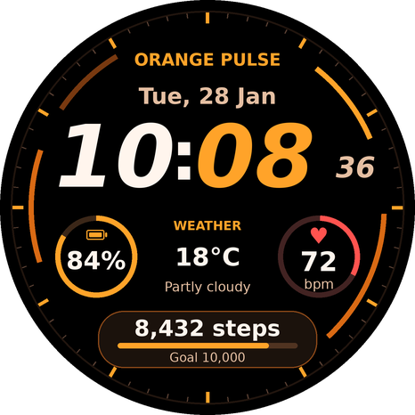

# Orange Pulse for OnePlus Watch 2R

Orange Pulse is a round, orange digital watch face built for Wear OS 4 and later
using Watch Face Format v1. It follows your watch’s 12- or 24-hour setting and
shows seconds, the date, battery charge, step-goal progress, heart rate, and
weather. In always-on mode the display dims and shows hours and minutes.



## Install from a OnePlus Nord 5

1. Download `Orange-Pulse-Watch-2R.apk` to the Nord 5. For GitHub Actions
   downloads, extract the artifact ZIP first.
2. Install [Bugjaeger Mobile ADB](https://play.google.com/store/apps/details?id=eu.sisik.hackendebug)
   on the Nord 5. Connect the phone and watch to the same Wi-Fi network. Keep the
   watch in Smart Mode.
3. On the watch, go to **Settings → System → About → Versions** and tap
   **Build number** repeatedly until Developer options are enabled. Menu names
   can vary by watch software version. In **Developer options**, turn on
   **ADB debugging** and **Wireless debugging**.
4. Open **Wireless debugging → Pair new device** on the watch. In Bugjaeger, tap
   the plug icon, then **Pair**. Enter the watch’s pairing IP address, port and
   code. After pairing, connect using the IP address and port on the main
   **Wireless debugging** screen. The pairing and connection ports differ.
5. In Bugjaeger, open **Packages → + → Select APK file** and pick
   `Orange-Pulse-Watch-2R.apk`. The APK is installed on the paired watch.
6. On the watch, touch and hold the current face. Swipe to **Add watch face**
   if needed, then choose **Orange Pulse**.

[Bugjaeger watch pairing guide](https://sisik.eu/blog/android/bugjaeger/connect-watch)

## Set up your readings

Battery and steps use Wear OS readings. The step bar follows the Wear OS
step goal. Heart rate uses the Wear OS sensor reading when available and
displays a dash when a reading is unavailable. You can choose a compatible
heart-rate provider in the face editor.

To add weather, touch and hold Orange Pulse, open **Edit**, then tap the
centre **Weather** slot and choose a weather provider installed on the watch.
Orange Pulse accepts short- or long-text weather providers. Temperature,
conditions and forecast details depend on what the chosen provider exposes.
If the picker has no weather option, install a compatible Wear OS weather
complication provider on the watch and finish its setup.

## Build from GitHub

Open **Actions → Build Orange Pulse APK → Run workflow**. The workflow also runs
on pushes and pull requests. After a successful run, download
**Orange-Pulse-Watch-2R** from the run’s **Artifacts** section and extract the APK.
CI validates the XML against Google’s WFF v1 schema and checks the APK signature.

For a local build, use Java 17 or 21, Android SDK Platform 35, Build Tools 35.0.0,
and the included Gradle wrapper.

```sh
./gradlew :app:assembleDebug
```

The result is `app/build/outputs/apk/debug/app-debug.apk`. Local and GitHub
Actions builds use their respective debug signing keys. To switch between
builds signed with different keys, uninstall the previous Orange Pulse
installation first and reapply your watch-face settings.
